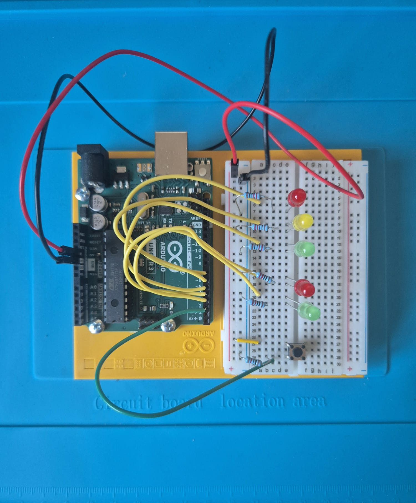
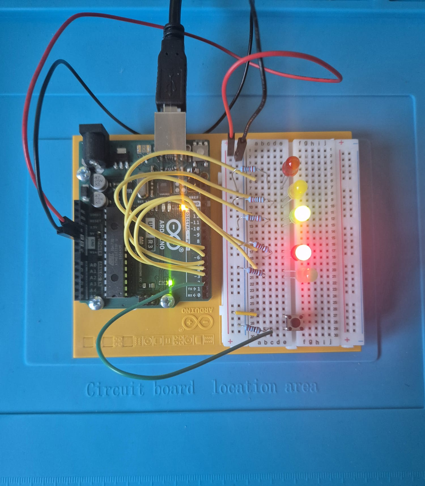

# 01 - Traffic Lights with Pedestrian Button

A traffic light for cars and pedestrians on an Arduino Uno. Cars have green
by default. When a pedestrian presses the button, the full crossing sequence
runs once.




## How it works

| Step | Cars | Pedestrians | Duration |
|---|---|---|---|
| Idle | green | red | until button press |
| 1 | yellow | red | 5 s |
| 2 | red | red | 5 s |
| 3 | red | green | 5 s |
| 4 | red | red | 5 s |
| 5 | yellow | red | 1 s |

After step 5 the program returns to idle.

## Parts

- Arduino Uno R3
- Breadboard and jumper wires
- 5 LEDs: red, yellow, green (cars), red, green (pedestrians)
- 5 x 220 ohm resistors (one per LED)
- 1 x 10 kohm resistor (button pull-down)
- 1 push button

## Pin map

| Pin | Connected to |
|---|---|
| D2 | Push button (with 10 kohm pull-down to GND) |
| D3 | Pedestrian green LED |
| D4 | Pedestrian red LED |
| D5 | Car green LED |
| D6 | Car yellow LED |
| D7 | Car red LED |

Each LED: pin -> LED anode -> LED cathode -> 220 ohm -> GND.
The button connects 5V to D2. Full schematic: [schematic/01-traffic-lights.pdf](schematic/01-traffic-lights.pdf)

## Build and upload

Requires VS Code with the PlatformIO extension.

```
pio run               # build
pio run -t upload     # upload to the board
```
## Credits

Own design. Inspired by Project 02 from the Arduino Starter Kit.
